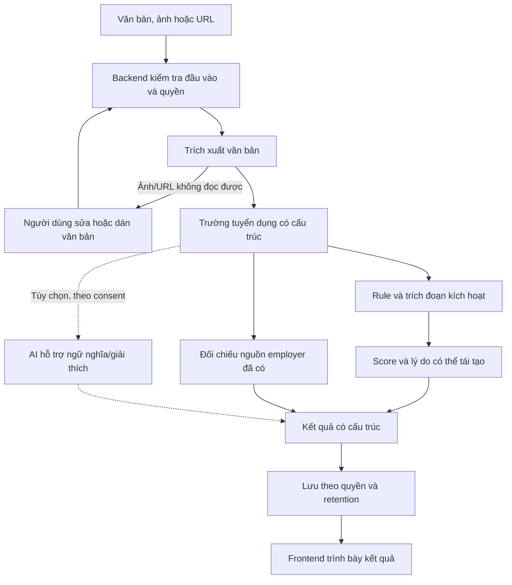
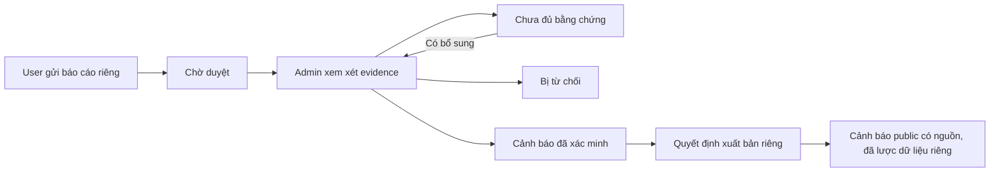

# JobShield — kiến trúc sản phẩm

Đọc sơ đồ luồng phân tích ở mục 2 để thấy mỗi phần dùng kết quả của phần trước.

**Trạng thái:** thiết kế G1A ngày 14/10/2026; chưa triển khai ứng dụng. Nguồn yêu cầu và giới hạn nằm trong [requirements.md](requirements.md); thứ tự thực hiện nằm trong [kế hoạch giai đoạn](superpowers/plans/2026-10-14-jobshield-phased-build.md).

Frontend shell/toolchain và backend environment G1 đã qua self-check theo hai ngoại lệ người dùng cho phép agent thiết lập môi trường. Python mới nhất chỉ nằm trong backend/.venv; các trách nhiệm API/Database/bảo mật và ranh giới tự học dưới đây vẫn áp dụng, chưa có tích hợp sản phẩm.

## 1. Thành phần và quyền quyết định

| Thành phần | Trách nhiệm | Không quyết định thay |
| --- | --- | --- |
| Next.js frontend | Thu đầu vào, cho sửa text, trình bày dữ liệu có cấu trúc, trạng thái và hành động tiếng Việt | Score chính thức, quyền đọc DB, trạng thái đã xác minh |
| FastAPI backend | Nhận yêu cầu hợp lệ, xác định quyền, điều phối service và lưu kết quả | Không coi client tự khai role/owner là đáng tin |
| Service thuần | Extraction text, rule matching, scoring, đối chiếu nguồn được truyền vào, kiểm tra transition | Không tự gọi mạng, query DB, đọc env hoặc cấp quyền |
| Database | Lưu danh tính, đầu vào cần giữ, snapshots/results, nguồn, report/evidence/audit | Không để dữ liệu demo thành nguồn xác minh thật |
| Adapter OCR/URL/LLM | Trích xuất hoặc hỗ trợ ngữ nghĩa, trả lỗi/fallback có cấu trúc | Không tự tạo evidence hoặc vượt hạn chế truy cập |

Giữ cây file hiện có. Route và schema là ranh giới API; model/session là ranh giới persistence; `core/` giữ cấu hình và bảo vệ; `services/` giữ nghiệp vụ và adapter. Không thêm microservice, queue, Redis hoặc wrapper repository khi luồng đồng bộ hiện tại chưa cần chúng.

## 2. Luồng phân tích chính

Sơ đồ mô tả trách nhiệm, không phải hợp đồng endpoint. Người dùng thiết kế request/response và schema tại G2; không viết code API hoặc SQL trong G1A.

### 2.1. Bản đầu tiên: chỉ văn bản, không-key

Người dùng gửi text; backend lấy rule/nguồn đã có, chạy extractor/matcher/score và comparison thuần, lưu kết quả rồi frontend đọc lại theo quyền. Đến G5, đường này phải chạy thật từ browser tới PostgreSQL trước khi thêm ảnh/URL hoặc bật LLM.

Rule engine phải giữ trích đoạn gốc và lý do. Extractor chỉ lấy được trường nào thì trả trường đó; trường chưa biết không được suy đoán thành doanh nghiệp/domain thật. Scoring sử dụng dữ liệu có cấu trúc và bộ rule cụ thể; lưu đủ dữ liệu/phiên bản để giải thích kết quả cũ sau khi admin đổi rule.

### 2.2. Mở rộng đầu vào

Ảnh/URL được đưa về cùng luồng text. Với OCR, cho kiểm tra/sửa text trước đánh giá; ảnh hỏng/rỗng cho fallback. Với URL, chỉ lấy trang công khai có thể truy cập hợp lệ; blocked/unsupported/timeout cho thông báo và đường dán text. Upload/SSRF/timeout/quyền tệp là phần người dùng triển khai G6, trước khi bật hai đầu vào này.

### 2.3. AI hỗ trợ

Không-key, không đồng ý gửi dữ liệu, timeout hoặc provider lỗi đều giữ đường rule-only. UI nêu rõ hạn chế. AI inference được phân biệt với trích đoạn và bằng chứng có nguồn; không biến nội dung LLM thành employer record hoặc nguồn chính thức.

Nếu AI giúp trích xuất, lưu dữ liệu có cấu trúc thực sự dùng để tính score; tính tái lập được đánh giá theo cùng dữ liệu và rule snapshot, không theo giả định hai lần gọi LLM luôn giống nhau. Điều phối provider, validation, disclosure/consent và giảm dữ liệu riêng do người dùng triển khai G7.

## 3. Kết quả cần mang những nhóm dữ liệu nào

| Nhóm hiển thị | Nguồn chịu trách nhiệm | Hành vi khi chưa có dữ liệu |
| --- | --- | --- |
| Thông tin tin đăng | Extraction và văn bản người dùng xác nhận | “Chưa có thông tin”, cho sửa văn bản |
| Risk/score/reasons | Rule engine và scoring policy | “Không đủ thông tin” nếu chưa đủ cơ sở; score không phải xác suất |
| Indicators/trích đoạn | Quy tắc kích hoạt từ nội dung thực | Không dựng indicator để lấp danh sách |
| Verification/confidence | Nguồn employer, contact/domain đối chiếu, timestamps | Chưa xác minh hoặc không đủ dữ liệu; không mặc định matched |
| Evidence và hành động | Trích đoạn, nguồn/thời điểm có thật, kết quả đối chiếu | Nêu nguồn thiếu và việc người dùng cần xác minh tiếp |

Risk có thể cao dù verification chưa có nguồn. Ngược lại, employer matched không chứng minh tin đăng an toàn. Kết quả không có dấu hiệu theo rule hiện tại cũng phải nói rõ hạn chế, thay vì nhãn “Đã chứng minh an toàn”.

Frontend dùng các component khung `risk-summary`, `indicator-list`, `verification-findings`, `evidence-list`, `recommended-actions` và `analysis-results`. Nguồn dữ liệu đi qua lớp tích hợp do người dùng triển khai; fixture chỉ để test component, không làm backend giả cho sản phẩm.

## 4. Luồng báo cáo và xuất bản

Mỗi quyết định có actor/time/notes và giữ lịch sử. Không submit trực tiếp thành verified, không lấy raw report hoặc evidence riêng làm public warning. Chuyển trạng thái thuần không thay role check hoặc kiểm tra đủ chứng cứ. G9 xây quy trình duyệt; G10 mới có đường xuất bản riêng.

## 5. Trách nhiệm theo file

| Vị trí | Nhiệm vụ | Chủ sở hữu |
| --- | --- | --- |
| `frontend/src/app/`, `components/` | Trang, layout và component hiển thị | Agent; guard/auth/data wiring do người dùng |
| `frontend/src/lib/api-client.ts`, `hooks/`, `providers/`, `types/api.ts` | Contract, request/query/session và lỗi từ backend | Người dùng |
| `backend/app/services/extraction.py`, `rule_engine.py`, `risk_assessment.py`, `employer_verification.py`, phần transition trong `report_moderation.py` | Logic thuần nhận dữ liệu từ caller | Agent |
| `backend/app/services/analysis.py`, `ocr.py`, `url_extraction.py`, `ai/`, `statistics.py` | Điều phối persistence/mạng/nguồn ngoài/thống kê từ DB | Người dùng |
| `backend/app/api/`, `schemas/`, `models/`, `db/`, `core/`, `alembic/`, `seed/` | API, dữ liệu, quyền, cấu hình, bảo vệ, migration và seed | Người dùng |
| Unit/component tests | Kiểm tra phần thuần/hiển thị | Agent khi có runtime và test runner |
| API/DB/auth/upload/URL/provider/E2E wiring và chạy stack | Kiểm tra ranh giới tự học | Người dùng, agent giải thích/hướng dẫn |
| Dockerfile, Compose, env và operational health/logs | Đóng gói và vận hành | Người dùng |

`domain.py` của G4 chỉ chứa kiểu nghiệp vụ thuần, không ORM hoặc schema API. Không đưa network/DB vào helper mang tên “thuần” để làm thay phần tự học. Việc một file TypeScript ở frontend không thay đổi quy tắc này.

## 6. Phụ thuộc giữa các giai đoạn

| Sau khi đạt | Có đầu vào để làm |
| --- | --- |
| G1 toolchain | G2 thiết kế và G3 kiểm chứng model/API trên môi trường thật |
| G2 dữ liệu/contract/quyền | G3 migration/auth, G4 kiểu nghiệp vụ và G5 UI/requests thống nhất |
| G3 DB/danh tính | G4 lưu kết quả không bỏ sót ownership |
| G4 text API và G5 UI tích hợp | G6 ảnh/URL dùng lại scoring và trang kết quả |
| G6 nguồn đầu vào an toàn | G7 AI chỉ nhận dữ liệu đã được xử lý theo policy |
| G8 dữ liệu cá nhân | G9 báo cáo dùng lại auth, quyền, list và cache |
| G9 moderation có evidence/audit | G10 nguồn/rule/statistics và xuất bản cảnh báo có kiểm soát |
| G10 đủ chức năng | G11 đóng gói ứng dụng thật, kiểm tra persistence và phục hồi |

Không-key là đường hoạt động đầy đủ cho core. Không bắt G8 chờ người dùng mua key LLM. Docker PostgreSQL đơn lẻ ở G3 nếu người dùng chọn phục vụ DB; build image frontend/backend và Compose toàn stack thuộc G11.

## 7. Quyết định G1 và phần người dùng sẽ tự thiết kế

G1 chốt ranh giới thành phần, luồng sản phẩm, stack, trách nhiệm A/U, nguyên tắc structured results và thứ tự giai đoạn. Các trang/field bắt buộc nằm trong `requirements.md` để không cần đoán lại khi viết UI.

G2 người dùng thiết kế ERD/constraint/index, API contracts/mã trạng thái, session và quyền guest/user/admin, retention và consent. G3 triển khai nền DB/auth; G4 lưu snapshot rule/đánh giá; G6/G7 chọn adapter thật. Đây là công việc có mục tiêu và checkpoint riêng trong kế hoạch, không phải quyết định đã được agent thực thi trong tài liệu G1.

Không thêm CI/CD, cloud, Grafana/Prometheus hoặc tích hợp chính phủ. Nghiệm thu cuối là MVP local end-to-end, không đồng nghĩa đã chứng minh ứng dụng sẵn sàng vận hành production công khai.

## 8. Bằng chứng và trạng thái G1

Rà soát ngày 14/10/2026: frontend Next 16.4.0/React 19.3.0/TypeScript 7.0.2 chạy trên Node 24.8.0 ARM64, có manifest/lockfile, Tailwind/shadcn và test runners. Vitest đạt 1 passed/3 todo; Chromium đạt 2 passed, gồm home/styles/focus và 17 đường dẫn 404 tiếng Việt. Các page khung có default export notFound; layout nhóm chỉ trả children, chưa có dữ liệu hoặc guard/auth. Build mặc định Turbopack được người dùng chạy thành công; build Webpack cũng đạt trong phiên agent.

Backend CPython 3.15.0, executable/prefix/base_prefix đều nằm trong backend/.venv; 30 dependency tương thích, uv.lock khớp manifest, 12 Pytest đạt. Settings chỉ kiểm tra quy ước môi trường, không kết nối Database. Python toàn máy vẫn 3.9.6. API/main/models/migrations và các module sản phẩm chưa triển khai.

G1A và G1U đạt phạm vi nền tảng theo hai ngoại lệ môi trường. Snapshot yêu cầu và kế hoạch đã được bỏ ignore riêng để có thể theo dõi trong Git; source gốc prompt.txt/AGENTS.md vẫn thiếu trên đĩa như provenance ghi trong requirements. Cách chạy hiện tại ở mục 10–11 của [development.md](development.md). Chưa chuyển G2; 7 high braces và ESLint vẫn hoãn. Docker engine chưa kiểm tra. MCP CodeGraph lỗi sau retry nên dùng fallback đọc trực tiếp, không sửa/cài/index lại công cụ.
